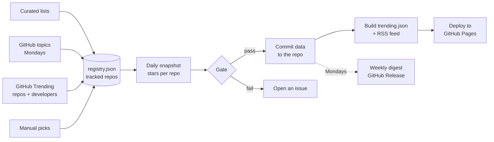

# Agent Trending

**What's rising in the AI agent ecosystem.** Agents, MCP servers, skills, plugins, marketplaces & AI tools — ranked by GitHub star growth, refreshed every morning.

[](https://mit2400.github.io/agent-trending/)

🔗 **Live leaderboard: https://mit2400.github.io/agent-trending/**

Agent Trending tracks about a thousand established repos around AI agents (Claude Code, Codex, Cursor, Gemini CLI, MCP servers, skills, plugins, marketplaces, agent frameworks and AI tools) and shows which ones are gaining stars fastest right now.

- 🔥 **Top gains**: most stars gained over the last 7 days
- 📈 **Fastest growing**: biggest growth in percent
- ✨ **New**: repos created in the last 30 days, or that joined the tracked set this week
- ⭐ **All-time**: total stars

You can filter every view by **type** (MCP, Skills, Plugins, Marketplaces, Agents, Frameworks, …) and **ecosystem** (Claude Code, Codex, Cursor, Gemini CLI, General), search by name, and share a filtered view: the URL keeps your tab and filters.

---

## Follow along

| How | What you get |
|---|---|
| [**RSS feed**](https://mit2400.github.io/agent-trending/feed.xml) | The daily top 10 gainers, for the last 14 days. Works with any feed reader, or Slack's `/feed subscribe`. |
| **Weekly email digest** | Every Monday a digest (top 20 gains, fastest growing, new entries, best per type) is published as a [GitHub Release](https://github.com/mit2400/agent-trending/releases). Click **Watch → Custom → Releases** on this repo and GitHub emails it to you. |
| **Digest archive** | The same digests as Markdown files in `data/digests/`, one per week (the first one is due Monday, Nov 30, 2026, once a full week of data exists). |

---

## What gets tracked

**Every tracked repo has at least 5,000 stars.** The goal is to follow trends worth following, not every new repo. The only exceptions are a few official repos added by hand (for example `cloudflare/mcp-server-cloudflare` and `supabase/mcp`), which are often more useful than their star count suggests.

Repos come from four places:

1. **Curated lists**: 19 awesome lists such as `punkpeye/awesome-mcp-servers`, `hesreallyhim/awesome-claude-code` and `ai-boost/awesome-harness-engineering`. Every GitHub link in them is a candidate. See [`data/sources.json`](data/sources.json).
2. **GitHub topics**: repos tagged with topics like `ai-agents`, `mcp-server`, `agent-skills` or `claude-code` (17 topics).
3. **GitHub Trending**: [trending repos](https://github.com/trending), plus the popular repo of each [trending developer](https://github.com/trending/developers). Only repos that look agent-related are added.
4. **Manual picks**: [`data/overrides.json`](data/overrides.json).

The footer of the page lists every source, with how many tracked repos each one supplies.

### Tags

- **Type** comes from the section of the list a repo appears in (for example "Agent Skills" → `skill`), from its GitHub topics, and from files in the repo:

  | File in the repo | Type |
  |---|---|
  | `SKILL.md` or a `skills/` folder | skill |
  | `.claude-plugin/plugin.json` or `gemini-extension.json` | plugin |
  | `.claude-plugin/marketplace.json` listing 3 or more plugins | marketplace (fewer than 3 → plugin) |

- **Ecosystem** comes from the list a repo was found in and from topics such as `claude-code`, `codex`, `cursor` and `gemini-cli`.

Tagging is rule-based (no LLM), so a few repos are untagged or tagged loosely.

---

## How the ranking works

- Every day at **08:30 KST** the star count of every tracked repo is saved as a snapshot.
- A repo's **gain** is today's stars minus its stars **7 days ago**.
- When less than a week of history exists (right after launch, or for a repo that joined recently), the oldest snapshot available is used instead. The page then shows the shorter window next to the number, for example `+40 · 2d`.
- **Fastest growing** divides the gain by the star count at the start of the window.

---

## How it works



Everything runs in one GitHub Actions workflow, [`.github/workflows/daily.yml`](.github/workflows/daily.yml), with no servers, databases or API keys beyond the built-in `GITHUB_TOKEN`.

| When | Step |
|---|---|
| Mondays | Re-read the curated lists, search GitHub topics, drop repos that fell below 5k stars, publish the weekly digest |
| Every day | Check GitHub Trending, collect stars, build the rankings, run the gate, commit the data, deploy the site |

**The gate** stops a bad run from being committed. It fails when:

- the snapshot covers less than 95% of the repos
- many repos suddenly lose most of their stars (a sign of an API problem)
- a file outside `data/` changed
- an already-committed snapshot would be overwritten

When it fails, nothing is committed and an issue is opened automatically.

**What is committed:** only the raw data: the registry and one small snapshot per day (about 30 KB compressed, about 10 MB per year). The rankings (`trending.json`) and the RSS feed are rebuilt from the snapshots on every deploy and are never committed.

---

## Repository layout

```
.github/workflows/daily.yml   the whole pipeline
tf/                           Python package
  sources.py                  parse curated lists → registry (+ 5k floor, pruning)
  discover.py                 GitHub topics + Trending (repos, developers)
  probe.py                    type tags from files in each repo
  collect.py                  daily star snapshot
  build.py                    rankings → trending.json
  gate.py                     data checks before committing
  publish.py                  RSS feed + weekly digest
  gh.py, common.py            GitHub client, shared helpers
data/
  sources.json                curated lists, discovery topics, tagging rules, star floor
  overrides.json              manual picks, tag overrides, blocklist
  registry.json               tracked repos (one per line)
  snapshots/YYYY-MM-DD.json   {repo id: stars} for each day
  digests/YYYY-Www.md         weekly digests
index.html, assets/           the static page (no build step, no framework)
tools/make_og.py              regenerates the social card (assets/og.png)
tests/                        pytest
```

Repos are keyed by their GitHub node ID, so renames and transfers don't break a repo's history.

---

## Common tasks

**Add a repo that is missing** (for example one under 5k stars, or one with no topics that no list mentions): add it to `include` in [`data/overrides.json`](data/overrides.json) with its tags.

```json
"tobi/qmd": { "type": ["tool", "mcp"], "scope": ["general"] }
```

**Hide a repo:** add `"owner/name"` to `block` in the same file.

**Fix a repo's tags:** add it under `tags` in the same file; manual tags always win.

**Add a curated list:** add an entry to `sources` in [`data/sources.json`](data/sources.json). Optional fields:

- `tags`: default type and ecosystem for everything in the list
- `skip_sections`: regular expressions for list sections to ignore
- `section_rules: false`: don't guess types from section headings
- `require_keywords: true`: only keep agent-related repos from a broad list

**Change the star floor or the discovery topics:** edit `min_stars` and `discovery` in `data/sources.json`.

All of these take effect on the next Monday run. To apply them now, use **Actions → daily → Run workflow**:

- **`sync_sources`**: re-read the lists and update the registry. This also collects today's stars, if they were not collected yet.
- **`deploy_only`**: just rebuild and redeploy the site, with no collection.

---

## Local development

Requires [uv](https://docs.astral.sh/uv/) and either the GitHub CLI logged in (`gh auth login`) or a `GITHUB_TOKEN` in the environment.

```bash
uv sync                                   # Python 3.12 + dependencies
uv run pytest -q                          # tests

uv run python -m tf.sources               # re-read curated lists (about 3 min)
uv run python -m tf.discover              # topics + trending (--trending-only, --since daily,weekly,monthly)
uv run python -m tf.collect               # today's snapshot
uv run python -m tf.build                 # data/trending.json
uv run python -m tf.gate                  # the checks the workflow runs
uv run python -m tf.publish feed --out feed.xml
uv run python -m tf.publish digest --force

python3 -m http.server                    # then open http://localhost:8000
```

Only the scheduled workflow should commit snapshots. If you collect locally to try something out, don't commit `data/snapshots/`. To try the page on throwaway data, build from another folder:

```bash
uv run python -m tf.build --snapshots .preview/snapshots --preview
```

---

Data comes from the public GitHub API. Star counts are taken as reported, and repos are not checked for star manipulation.
